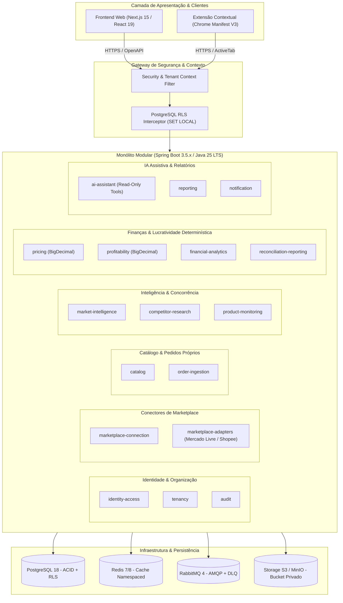

# Arquitetura de Software — Seller Intelligence Platform

> **Padrão Arquitetural:** Monólito Modular (Modular Monolith)  
> **Status:** Baseline Aprovado &middot; **Versão:** 1.0.0  
> **Garantias:** Spring Modulith, ArchUnit, Zero Dependências Cíclicas, Isolamento Multi-Tenant Estrito  

---

## 1. Princípios Arquiteturais Fundamentais

A **Seller Intelligence Platform** é estruturada como um **Monólito Modular** com fronteiras rígidas de domínio. Não adotamos microsserviços antecipadamente para evitar complexidade operacional prematura, latência de rede e transações distribuídas desnecessárias.

### 1.1 Invariantes Estruturais
1. **Limites de Domínio Rígidos:** Cada módulo possui seu pacote raiz e expõe apenas contratos públicos (interfaces Java, DTOs e eventos de domínio). O acesso direto a entidades JPA, repositórios ou tabelas internas de outro módulo é categoricamente proibido e verificado por testes de arquitetura com **ArchUnit**.
2. **Dependências Direcionais e Sem Ciclos:** Módulos de domínio superior dependem de módulos de infraestrutura/base, nunca o inverso. Dependências cíclicas entre módulos impedem a compilação.
3. **Core Agnóstico a Marketplaces:** Regras de precificação, cálculo de margem, reconciliação e catálogo são universais e desconhecem regras proprietárias de APIs externas. Adaptações de canais vivem estritamente na camada de adaptadores (`marketplace-adapters`).
4. **Isolamento de Dados Multi-Tenant:** Toda entidade tenant-scoped contém a coluna `tenant_id NOT NULL`. A aplicação injeta e valida o tenant context no início de cada requisição/job e o PostgreSQL aplica Row-Level Security (RLS) como defesa adicional.
5. **Comunicação por Eventos Assíncronos:** Processamentos demorados (sincronização de catálogo, ingestão de pedidos, cálculo massivo) ocorrem via mensagens assíncronas no RabbitMQ com filas dedicadas, idempotência e Dead-Letter Queues (DLQ).

---

## 2. Visão Geral da Arquitetura do Sistema



---

## 3. Catálogo e Responsabilidade dos Módulos de Domínio

Em conformidade com a Seção 7 do PRD, o monólito é composto por 17 módulos delimitados:

| Módulo | Escopo e Responsabilidade Principal | Comunicação Externa Permitida |
|---|---|---|
| `identity-access` | Autenticação mínima, emissão e validação de tokens JWT/OIDC, principal autenticado. | Keycloak OIDC Provider |
| `tenancy` | Gestão de organizações, empresas (CNPJs), membros, contas e resolução do tenant confiável. | Interna |
| `marketplace-connection` | Gestão de conexões OAuth, rotação de tokens cifrados (AES-256-GCM), health status de contas. | OAuth Portals Oficiais |
| `marketplace-adapters` | Implementação de conectores específicos (`MercadoLivreAdapter`, `ShopeeAdapter`) via interface `MarketplaceConnector`. | APIs Oficiais de Marketplaces |
| `catalog` | Catálogo canônico interno de produtos, SKUs, dimensões, atributos e relacionamento com anúncios. | Interna |
| `order-ingestion` | Ingestão idempotente e assíncrona de pedidos, itens, cancelamentos e devoluções. | Fila RabbitMQ |
| `market-intelligence` | Pesquisa de produtos em fontes públicas autorizadas com rotulagem estrita de proveniência (`OBSERVED`). | APIs Oficiais Públicas |
| `competitor-research` | Gestão de grupos de concorrentes e benchmarking de preços observados. | Interna |
| `product-monitoring` | Agendamento e captura de snapshots históricos de anúncios e produtos a partir da inclusão. | Fila RabbitMQ / Scheduler |
| `pricing` | Parametrização versionada de taxas, fretes e impostos; simulador de preço determinístico em `BigDecimal`. | Interna |
| `profitability` | Apuração determinística de margem de contribuição, break-even e lucro por SKU, canal e CNPJ. | Interna |
| `financial-analytics` | Consolidação financeira de faturamento, deduções, taxas e custos por período. | Interna |
| `listing-analytics` | Métricas de anúncios próprios concedidas oficialmente pelas APIs (visitas, conversão, cliques). | APIs Oficiais de Sellers |
| `ai-assistant` | Assistente conversacional fundamentado em RAG interno e tool calling somente leitura (`BLOCKED_MUTABLE`). | Provedor LLM homologado |
| `reporting` | Geração de relatórios analíticos e exportação em CSV/XLSX com auditoria de download. | MinIO / S3 Privado |
| `notification` | Inbox de alertas do seller, notificações operacionais e regras de deduplicação temporal. | Webhooks / WebSocket |
| `audit` | Trilha imutável de eventos de auditoria para ações sensíveis e alterações de credenciais/taxas. | PostgreSQL Audit Table |

---

## 4. Regras de Acoplamento e Comunicação Entre Módulos

```
                                    ┌──────────────────────┐
                                    │    Módulo Chamador   │
                                    └──────────┬───────────┘
                                               │
                        ┌──────────────────────┴──────────────────────┐
                        ▼                                             ▼
             (Chamada Síncrona via Contrato)              (Evento de Domínio Assíncrono)
                        │                                             │
                        ▼                                             ▼
           ┌────────────────────────┐                    ┌────────────────────────┐
           │   Java Interface / DTO │                    │     Spring / AMQP      │
           │    do Módulo Alvo      │                    │     Domain Event       │
           └────────────┬───────────┘                    └────────────┬───────────┘
                        ▼                                             ▼
           ┌────────────────────────┐                    ┌────────────────────────┐
           │   Service Interno do   │                    │     EventListener      │
           │      Módulo Alvo       │                    │    do Módulo Alvo      │
           └────────────┬───────────┘                    └────────────┬───────────┘
                        ▼                                             ▼
           ┌────────────────────────┐                    ┌────────────────────────┐
           │   Repositório / Banco  │                    │   Repositório / Banco  │
           │     do Módulo Alvo     │                    │     do Módulo Alvo     │
           └────────────────────────┘                    └────────────────────────┘
```

1. **Chamada Direta:** Ocorre exclusivamente através de interfaces públicas anotadas ou registradas no pacote raiz do módulo exportador.
2. **Eventos de Domínio:** Utilizados para desacoplar efeitos colaterais (ex.: `OrderIngestedEvent` emitido pelo módulo de pedidos é escutado pelo módulo de lucratividade sem dependência direta).
3. **Proibição de Cross-Table Joins:** Nenhum módulo pode realizar consultas `JOIN` ou queries SQL envolvendo tabelas pertencentes a outros módulos sem mediação pelo contrato do módulo.

---

## 5. Estratégia de Migração e Persistência de Dados
- **Ferramenta de Migração:** Flyway com nomenclatura determinística `V<versao>__<descricao>.sql`.
- **Compatibilidade Retroativa:** Toda alteração de schema deve ser compatível com a versão anterior (padrão Expand and Contract).
- **Tipos Monetários:** Todas as colunas de valor monetário, taxa, comissão ou imposto utilizam `NUMERIC(15, 4)` ou `NUMERIC(12, 2)`, jamais ponto flutuante.
- **Identificadores:** Chaves primárias usam `UUIDv7` ordenável por tempo gerado nativamente ou via aplicação.
