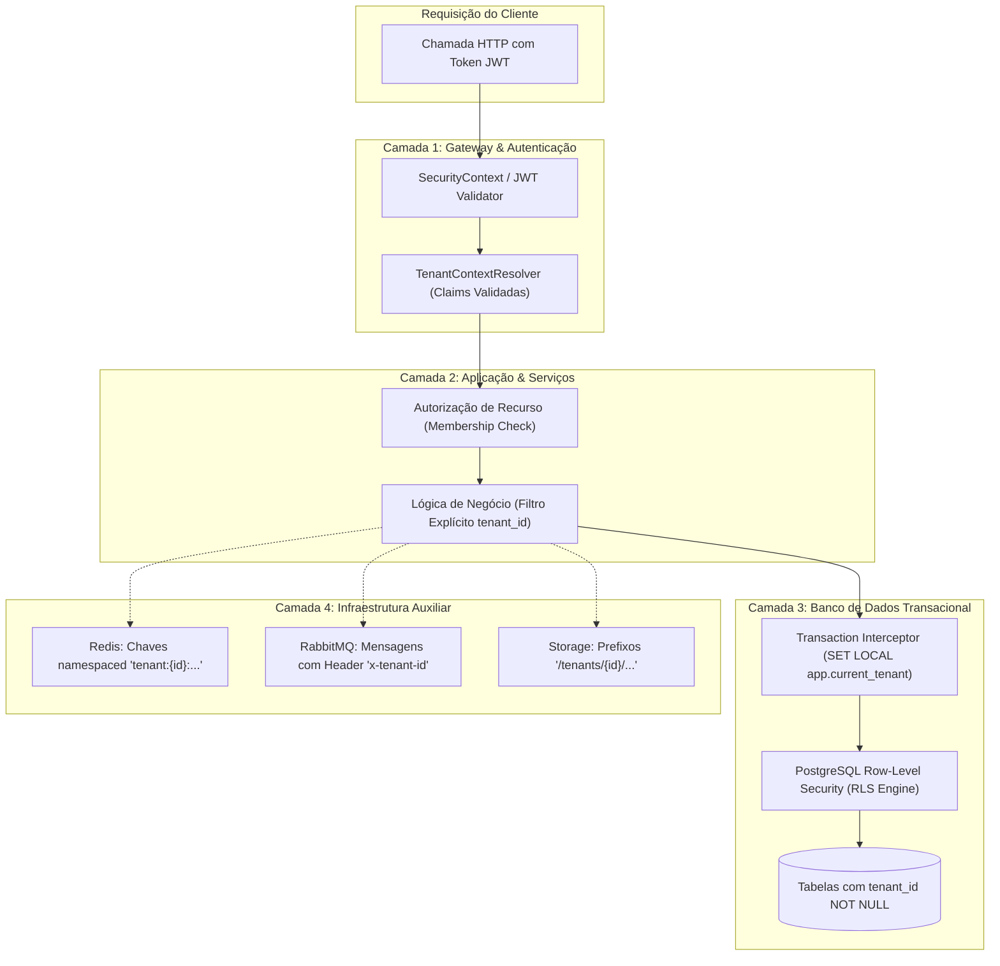

# Diretrizes de Segurança, Proteção de Dados e Isolamento Multi-Tenant

> **Documento de Segurança Obrigatório** &middot; **Versão:** 1.0.0  
> **Classificação:** Segurança da Informação & Compliance  
> **Baseline de Referência:** OWASP ASVS Nível 2 &middot; LGPD (Lei 13.709/2018) &middot; Multi-Tenant Defense-in-Depth  

---

## 1. Modelo de Segurança Multi-Tenant (Defesa em Profundidade)

A **Seller Intelligence Platform** adota uma estratégia de **Defesa em Profundidade** para garantir que sob nenhuma hipótese ocorra vazamento ou acesso cruzado entre dados de diferentes clientes (tenants).



### 1.1 Regras Rígidas de Resolução de Tenant
1. **Identidade Confiável:** O identificador do tenant (`tenant_id`) é resolvido unicamente através do token criptográfico assinado (JWT emitido pelo Keycloak) e membership validada no banco de dados.
2. **Proibição de Confiança Cega em Headers:** Parâmetros de rota (`/api/{tenantId}/...`) ou headers (`X-Tenant-Id`) são categoricamente rejeitados se não corresponderem exatamente aos privilégios do principal autenticado.
3. **Impossibilidade de Impersonação Não Auditada:** Nenhuma operação administrativa pode alterar o tenant de uma requisição sem registro formal no log de auditoria imutável.

### 1.2 Isolamento no Banco de Dados (PostgreSQL RLS)
1. **Coluna Mandatória:** Toda tabela que armazena dados de sellers possui obrigatoriamente a coluna `tenant_id UUID NOT NULL REFERENCES organizations(id)`.
2. **Ativação de RLS:** Toda tabela tenant-scoped possui a instrução `ALTER TABLE <tabela> ENABLE ROW LEVEL SECURITY;` e `ALTER TABLE <tabela> FORCE ROW LEVEL SECURITY;`.
3. **Política de Isolamento:**
   ```sql
   CREATE POLICY tenant_isolation_policy ON <tabela>
     FOR ALL
     USING (tenant_id = NULLIF(current_setting('app.current_tenant', true), '')::uuid);
   ```
4. **Ciclo de Vida da Sessão:** A cada abertura de transação JDBC/JPA, o interceptor executa:
   ```sql
   SET LOCAL app.current_tenant = '<tenant-id>';
   ```
   Ao fechar a transação ou retornar a conexão ao pool (HikariCP), o contexto é limpo automaticamente (`RESET app.current_tenant`).
5. **Aplicação não depende unicamente do RLS:** O RLS é uma camada secundária de contenção de desastres. Todos os repositórios Spring Data JPA continuam filtrando explicitamente por `tenantId` em suas consultas.

### 1.3 Isolamento em Cache, Filas e Armazenamento
- **Redis:** Toda chave de cache volátil ou lock distribuído é formatada com prefixo obrigatório: `tenant:{tenant_id}:{entidade}:{id}`.
- **RabbitMQ:** Toda mensagem assíncrona carrega nos headers o campo `x-tenant-id`. Consumidores validam a existência e consistência do tenant antes de processar o evento.
- **Object Storage (S3 / MinIO):** O upload de catálogos PDF, planilhas e imagens é isolado em prefixos de bucket `/tenants/{tenant_id}/...`. O acesso ocorre exclusivamente via URLs pré-assinadas com tempo de expiração curto (máximo 15 minutos).

---

## 2. Criptografia e Gestão de Segredos

### 2.1 Criptografia de Tokens OAuth em Repouso
- **Algoritmo Padrão:** **AES-256-GCM** com vetor de inicialização (IV) aleatório de 96 bits por registro e tag de autenticação de 128 bits.
- **Chave Mestra:** Injetada via variável de ambiente `ENCRYPTION_SECRET_KEY` ou secret manager de nuvem (HashiCorp Vault / AWS Secrets Manager). **Nunca versionada no Git.**
- **Envelope Encryption:** O token de acesso e refresh token de contas de marketplaces são cifrados antes da persistência no PostgreSQL e decifrados somente na memória do conector no instante da chamada HTTP.

### 2.2 Prevenção de Vazamento em Logs e Mensagens (Sanitização)
- Todo payload de log estruturado passa por filtro regex automático (Logback Pattern Masking) que substitui por `[REDACTED]`:
  - Tokens OAuth (`access_token`, `refresh_token`, `authorization_code`).
  - Chaves de API, senhas e hashes.
  - Dados pessoais identificáveis (PII): CPF, e-mail de compradores, telefones e endereços de entrega completos.

---

## 3. Hardening e Mitigação de Ameaças (OWASP ASVS Nível 2)

### 3.1 Proteção Contra SSRF (Server-Side Request Forgery)
Para módulos que realizam requisições para URLs fornecidas externamente (ex.: download de imagens de produtos, webhooks de parceiros):
1. **Validação Estrita de URL:** O hostname é inspecionado contra allowlist oficial de domínios permitidos (ex.: `*.mercadolivre.com.br`, `*.shopee.com.br`).
2. **Bloqueio de Redes Privadas:** O resolvedor DNS valida o IP de destino e bloqueia imediatamente se pertencer a faixas privadas ou de loopback:
   - `10.0.0.0/8`, `172.16.0.0/12`, `192.168.0.0/16`
   - `127.0.0.0/8`, `::1`
   - Link-local e endpoints de metadados de nuvem: `169.254.169.254`
3. **Bloqueio de Redirects Perigosos:** Desabilitado o seguimento automático de redirecionamentos HTTP (`allowRedirects = false`).

### 3.2 Proteção Contra Injeção e Manipulação de Arquivos
1. **Uploads de Arquivos (PDF e Imagens):**
   - Validação real de cabeçalho MIME (*magic bytes*) via Apache Tika ou biblioteca equivalente; não confiar na extensão `.pdf` ou `.jpg`.
   - Limite rígido de tamanho: máximo 15MB por arquivo.
   - Nomes de arquivo higienizados via UUID aleatório para evitar ataques de *Directory Traversal* (`../../`).
2. **Sanitização de Fórmulas CSV:**
   - Na exportação de relatórios tabulares, qualquer célula iniciada com `=`, `+`, `-`, `@` ou caracteres de controle tem o caractere neutralizado para impedir execução indevida de fórmulas no Microsoft Excel ou Google Sheets (CSV Injection).

### 3.3 Headers de Segurança HTTP
O Spring Security e o Next.js são configurados para emitir obrigatoriamente:
- `Strict-Transport-Security: max-age=63072000; includeSubDomains; preload`
- `X-Content-Type-Options: nosniff`
- `X-Frame-Options: DENY`
- `Content-Security-Policy: default-src 'self'; img-src 'self' data: https:; script-src 'self'; style-src 'self' 'unsafe-inline'; font-src 'self';`
- `Referrer-Policy: strict-origin-when-cross-origin`
- `Permissions-Policy: geolocation=(), camera=(), microphone=()`
