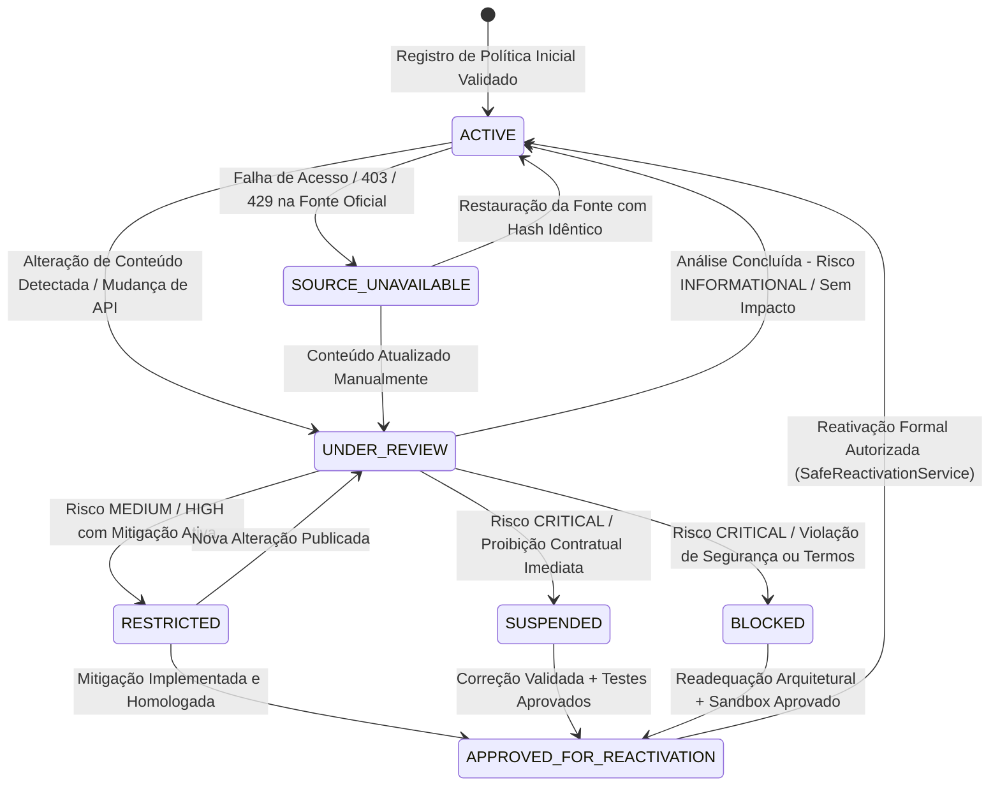

# Ciclo de Vida de Conformidade e Políticas (Compliance Lifecycle)

## 1. Visão Geral
O ciclo de vida de conformidade da **Seller Intelligence Platform** governa o estado de políticas de marketplaces, escopos de autorização OAuth, ciclos de vida de APIs e disponibilidade operacional de funcionalidades.

O sistema opera sob o paradigma de **Transições Auditáveis e Fail Closed**: nenhuma funcionalidade degradada pode retornar à operação normal sem processo formal de aprovação e evidência comprovada.

---

## 2. Máquina de Estados de Políticas e Funcionalidades



---

## 3. Descrição Detalhada dos Estados

### 3.1. `ACTIVE`
- **Definição:** A política e as integrações associadas estão em total conformidade operacional.
- **Comportamento do Sistema:** Todas as funcionalidades permitidas pelo marketplace (sincronização de catálogo, cálculo de margens, atualização de anúncios, monitoramento de pedidos) operam normalmente dentro dos rate limits definidos.
- **Gatilho de Saída:** Detecção de alteração no conteúdo oficial, notificação de deprecamento de API ou falha na consulta da fonte.

### 3.2. `UNDER_REVIEW`
- **Definição:** Uma alteração foi detectada na documentação oficial ou termos, ou uma nova política foi registrada e aguarda conclusão de triagem.
- **Comportamento do Sistema:** O `ComplianceImpactAnalyzer` e o `RiskAssessmentEngine` avaliam o escopo funcional. Caso o risco preliminar seja avaliado como `HIGH` ou `CRITICAL`, aplica-se bloqueio preventivo temporário nas rotas afetadas.
- **Tempo Máximo no Estado:** 24 horas (SLA de triagem).

### 3.3. `RESTRICTED`
- **Definição:** A funcionalidade permanece operando, porém sob restrições técnicas obrigatórias (ex.: redução de taxa de chamadas por minuto, limitação de campos transmitidos, ou obrigatoriedade de confirmação manual em duas etapas).
- **Comportamento do Sistema:** O `MarketplaceComplianceGuard` injeta restrições dinâmicas nas requisições.

### 3.4. `SUSPENDED`
- **Definição:** Funcionalidade suspensa temporariamente devido a risco iminente de não-conformidade (ex.: endpoint deprecated com data de corte próxima ou alteração contratual que exige atualização de termos de consentimento).
- **Comportamento do Sistema:** `AutomaticComplianceEnforcer` intercepta qualquer chamada para a feature específica com HTTP 423 (Locked) ou exceção de negócio `ComplianceBlockException`. Demais funcionalidades continuam ativas.

### 3.5. `BLOCKED`
- **Definição:** Bloqueio mandatório por violação de termos de uso, suspensão de acesso de desenvolvedor ou risco crítico à segurança de contas de sellers.
- **Comportamento do Sistema:** Parada total imediata de qualquer operação relacionada ao marketplace ou módulo afetado. Envio imediato de alerta aos administradores.

### 3.6. `APPROVED_FOR_REACTIVATION`
- **Definição:** Estado transitório no qual as alterações técnicas foram concluídas, a suíte de testes de compliance foi aprovada e a homologação documental foi atestada.
- **Comportamento do Sistema:** A feature permanece bloqueada para tráfego produtivo até a assinatura digital do responsável no `SafeReactivationService`.

### 3.7. `SOURCE_UNAVAILABLE`
- **Definição:** A URL oficial de monitoramento retornou erro técnico, indisponibilidade temporária ou restrição de robô.
- **Comportamento do Sistema:** As funcionalidades operacionais continuam funcionando se o status prévio era `ACTIVE`, mas é gerado alerta operacional para revisão manual da fonte.

---

## 4. Ciclo de Vida de Permissões e Escopos OAuth

Os tokens de autorização de cada loja integrada possuem escopos granulares concedidos pelo seller (ex.: `read_orders`, `write_listings`, `read_inventory`).

### 4.1. Detecção de Alteração de Escopo
O `PermissionAuthorizationValidator` valida periodicamente e antes de qualquer mutação externa:
1. Se o token possui o escopo mandatório exigido para a operação pretendida.
2. Se o marketplace introduziu novos escopos obrigatórios ou depreciou escopos vigentes.

### 4.2. Tratamento de Revogação Parcial
Se o seller revogar a permissão de escrita de anúncios (`write_listings`):
- A funcionalidade de publicação/edição de anúncios é imediatamente desabilitada no frontend e bloqueada no backend.
- A sincronização de leitura de pedidos e conciliação financeira permanece ativa (`read_orders`), mantendo o isolamento de impacto.

---

## 5. Ciclo de Vida de APIs de Marketplaces

A plataforma monitora e classifica os endpoints oficiais nas seguintes fases:

```
[BETA / CANDIDATE] --> [ACTIVE / GENERAL_AVAILABILITY] --> [DEPRECATED] --> [SUNSET_SCHEDULED] --> [RETIRED]
```

1. **GENERAL_AVAILABILITY:** Endpoint estável e recomendado pelo marketplace.
2. **DEPRECATED:** O marketplace anunciou que o endpoint será descontinuado em versão futura. A plataforma gera incidente com severidade `MEDIUM` e abre plano de migração.
3. **SUNSET_SCHEDULED:** Data limite formal estabelecida pelo marketplace (ex.: 30 dias para desligamento). O incidente é elevado para `HIGH`.
4. **RETIRED:** Endpoint desligado na fonte. A plataforma transita o status da feature correspondente para `SUSPENDED` caso a nova versão ainda não tenha sido ativada.
