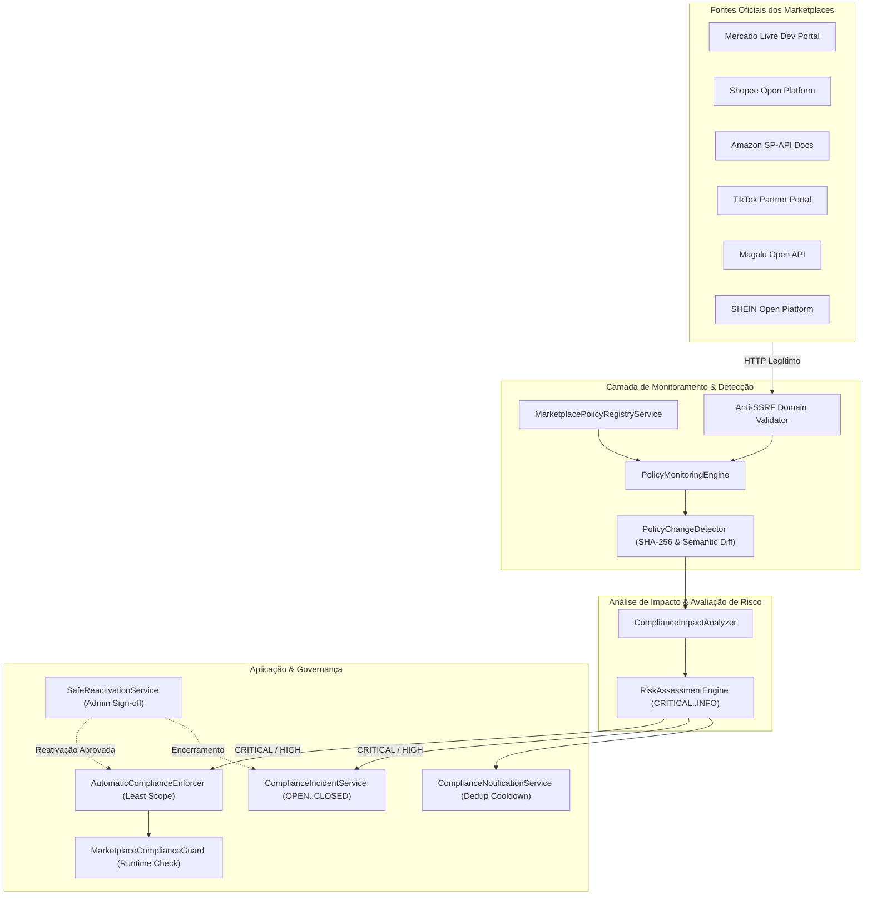

# Arquitetura do Continuous Marketplace Compliance Engine

**Plataforma:** Seller Intelligence Platform  
**Data:** 17 de Novembro de 2026  
**Versão:** 1.0.0  
**Status:** `APPROVED / ENFORCED`  

---

## 1. Visão Geral e Princípios Arquiteturais

A conformidade com as regras, APIs e políticas dos marketplaces é tratada na **Seller Intelligence Platform** como uma **propriedade arquitetural contínua e permanente**, integrada ao ciclo de vida de execução de software.

O **Continuous Marketplace Compliance Engine** expande o `MarketplaceComplianceGuard` para garantir governança preventiva ininterrupta contra:
- Alterações inesperadas em termos de serviço e políticas de desenvolvedores.
- Mudanças ou reduções de limites operacionais de requisições (rate limits).
- Depreciação ou descontinuação (sunset) de versões de APIs.
- Revogação ou alteração de escopos OAuth 2.0.
- Riscos operacionais de suspensão ou banimento de contas de vendedores.

### Princípios Norteadores
1. **FAIL CLOSED Absoluto:** Qualquer operação cuja conformidade não possa ser atestada com certeza determinística é sumariamente bloqueada no backend.
2. **Princípio do Menor Escopo (Least Scope Enforcement):** Bloqueios automáticos afetam estritamente a funcionalidade ou endpoint impactado (ex.: suspensão de atualização de preços), preservando operações legítimas não afetadas (ex.: sincronização de pedidos).
3. **SSRF Protection:** Qualquer checagem de URLs externas passa por validação rigorosa anti-SSRF contra allowlist estrita de domínios oficiais, bloqueando endereços locais e metadados de nuvem.
4. **Proibição de Reativação Automática:** Nenhuma funcionalidade bloqueada pode ser reativada automaticamente; a reativação exige aprovação formal de administrador autenticado, evidência documental e comprovação de testes automatizados.

---

## 2. Diagrama de Fluxo e Componentes

---

## 3. Estrutura Modular dos Componentes

O subsistema está organizado no pacote `br.com.sellerintelligence.compliance` nos seguintes módulos:

### 3.1. Policy Registry (`policy-registry`)
- **Entidade:** `MarketplacePolicy`
- **Responsabilidade:** Catálogo centralizado das políticas, termos de uso, diretrizes de automação e limites dos marketplaces homologados e em expansão.
- **Campos Chave:** `marketplace`, `policy_type`, `official_url`, `policy_version`, `effective_date`, `last_checked_at`, `content_hash`, `status`, `risk_level`, `affected_feature`.

### 3.2. Policy Monitoring Engine (`policy-monitoring`)
- **Classe:** `PolicyMonitoringEngine`
- **Responsabilidade:** Verificação periódica ou sob demanda das fontes cadastradas. Computa hashes SHA-256 e detecta indisponibilidade (`SOURCE_UNAVAILABLE`).
- **Segurança:** Invoca `UrlSecurityValidator.validatePolicyMonitoringUrl` para impedir ataques de Server-Side Request Forgery (SSRF).

### 3.3. Policy Change Detection (`change-detection`)
- **Classe:** `PolicyChangeDetector`
- **Responsabilidade:** Identifica se o conteúdo divergiu do hash registrado. Compara o texto normalizado (`isFormattingOnlyChange`) para desconsiderar variações estéticas de espaçamento, classificando alterações irrelevantes como `FORMATTING_ONLY` (`INFORMATIONAL`).

### 3.4. Compliance Impact Analyzer (`impact-analysis`)
- **Classe:** `ComplianceImpactAnalyzer`
- **Responsabilidade:** Mapeia a alteração para funcionalidades concretas da plataforma (`SYNC_ORDERS`, `SYNC_CATALOG`, `PRICE_UPDATE`, `AI_LISTING_STUDIO`, `PUBLIC_SEARCH`, `BROWSER_EXTENSION`).

### 3.5. Risk Assessment Engine (`risk-assessment`)
- **Classe:** `RiskAssessmentEngine`
- **Responsabilidade:** Avaliação determinística de risco em 5 níveis (`CRITICAL`, `HIGH`, `MEDIUM`, `LOW`, `INFORMATIONAL`) com base na natureza da mudança e palavras-chave regulatórias.

### 3.6. Automatic Compliance Enforcement (`compliance-enforcement`)
- **Classe:** `AutomaticComplianceEnforcer`
- **Responsabilidade:** Aplica a restrição sob o princípio do menor escopo (`FeatureEnforcementRecord`), suspendendo a funcionalidade afetada sem indisponibilizar o canal inteiro.

### 3.7. Permission & Authorization Validator (`permission-validator`)
- **Classe:** `PermissionAuthorizationValidator`
- **Responsabilidade:** Introspecção e validação de escopos OAuth 2.0 e vigência de tokens em lojas conectadas.

### 3.8. API Lifecycle Monitor (`api-lifecycle-monitor`)
- **Classe:** `ApiLifecycleMonitor`
- **Responsabilidade:** Rastreia versões ativas e deprecadas de APIs, emitindo alertas preventivos quando datas de sunset se aproximam.

### 3.9. Compliance Incident Management (`incident-management`)
- **Classe:** `ComplianceIncidentService`
- **Responsabilidade:** Ciclo formal de incidentes (`OPEN` -> `INVESTIGATING` -> `MITIGATING` -> `RESOLVED` -> `CLOSED`).

### 3.10. Safe Reactivation (`safe-reactivation`)
- **Classe:** `SafeReactivationService`
- **Responsabilidade:** Barreira de governança que impede reativação automática. Exige identificador do aprovador, evidência documental e comprovação de testes automatizados executados.

---

## 4. Esquema de Persistência Relacional (Flyway V14)

1. `marketplace_policies`: Catálogo imutável de fontes e hashes.
2. `marketplace_policy_changes`: Histórico de versões e deltas de conteúdo.
3. `compliance_incidents`: Incidentes abertos por riscos críticos ou altos.
4. `marketplace_api_lifecycles`: Matriz de ciclo de vida e versões de APIs.
5. `feature_enforcement_records`: Estado operacional de cada funcionalidade por marketplace.
6. `safe_reactivation_logs`: Trilha de auditoria para reativações autorizadas.
