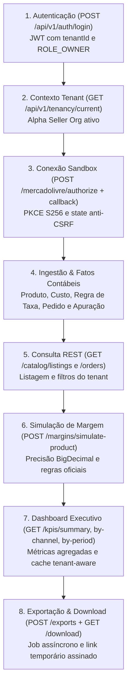

# Runbook Operacional: Execução e Validação do Pipeline E2E e Suíte de Resiliência (P023-BE/QA)

> **Documento:** Runbook de Testes de Integração Ponta a Ponta e Resiliência  
> **Versão:** 1.0.0 &middot; **Status:** HOMOLOGADO  
> **Data:** 23/11/2026 &middot; **Responsável:** Seller Intelligence Platform QA & Core Engineering  
> **Target:** Backend Spring Boot 3.5.16 / JUnit 5 / Testcontainers / PostgreSQL 17 / MockMvc

---

## 1. Visão Geral

Este runbook documenta o procedimento padronizado para execução, reprodução e auditoria dos cenários de teste ponta a ponta (E2E) e de resiliência a falhas da **Seller Intelligence Platform**, implementados sob o escopo do prompt **P023-BE/QA**.

A suíte foi concebida para validar o fluxo operacional completo do vendedor (desde a autenticação até a exportação e download auditado de relatórios), assim como as defesas arquiteturais do sistema diante de 8 categorias de caos, indisponibilidade externa e tentativas de intrusão cross-tenant.

---

## 2. Estrutura das Classes de Teste

A suíte está organizada no pacote canônico `com.sellerintelligence.e2e` sob `backend/src/test/java/com/sellerintelligence/e2e/`:

| Classe de Teste | Arquivo Fonte | Responsabilidade |
| :--- | :--- | :--- |
| **`EndToEndLifecycleIntegrationTest`** | [`EndToEndLifecycleIntegrationTest.java`](file:///home/alexandre/Projetos/antigravity-avantepro-clone/backend/src/test/java/com/sellerintelligence/e2e/EndToEndLifecycleIntegrationTest.java) | Validação sequencial do ciclo de vida completo feliz em 8 etapas encadeadas com persistência real |
| **`SystemResilienceAndSecurityIntegrationTest`** | [`SystemResilienceAndSecurityIntegrationTest.java`](file:///home/alexandre/Projetos/antigravity-avantepro-clone/backend/src/test/java/com/sellerintelligence/e2e/SystemResilienceAndSecurityIntegrationTest.java) | Validação exaustiva dos 8 cenários críticos de falha, rate limit, retries, DLQ e isolamento de segurança |

---

## 3. Comandos de Reprodução Rápida

### 3.1 Execução Direta da Suíte E2E / Resiliência

Para executar exclusivamente as classes de teste de E2E e Resiliência:

```bash
cd backend
./mvnw test -Dtest="EndToEndLifecycleIntegrationTest,SystemResilienceAndSecurityIntegrationTest"
```

**Resultado Esperado:**
```text
[INFO] Running P023-BE/QA: EndToEndLifecycleIntegrationTest — Pipeline E2E Completo
[INFO] Tests run: 1, Failures: 0, Errors: 0, Skipped: 0, Time elapsed: 7.582 s
[INFO] Running P023-BE/QA: SystemResilienceAndSecurityIntegrationTest — Cenários de Caos e Resiliência
[INFO] Tests run: 9, Failures: 0, Errors: 0, Skipped: 0, Time elapsed: 0.601 s
[INFO] Results:
[INFO] Tests run: 10, Failures: 0, Errors: 0, Skipped: 0
[INFO] BUILD SUCCESS
```

### 3.2 Execução Global de Validação do Backend (509 Testes)

```bash
cd backend
./mvnw test
```

### 3.3 Execução Global de Validação do Frontend (260 Testes)

```bash
cd frontend
npm test -- --run
```

---

## 4. Detalhamento do Pipeline E2E (`EndToEndLifecycleIntegrationTest`)

A esteira executa o ciclo completo em 8 etapas estritamente encadeadas:



1. **Passo 1 (Autenticação):** Login via `POST /api/v1/auth/login` com credenciais válidas (`seller@example.com`), obtendo JWT com claims assinadas contendo `tenantId = 11111111-1111-1111-1111-111111111111` e `ROLE_OWNER`.
2. **Passo 2 (Tenant Context):** Consulta a `GET /api/v1/tenancy/current` validando o isolamento e status organizacional (`Alpha Seller Org`).
3. **Passo 3 (Conectar Marketplace Sandbox):** Iniciação OAuth via `POST /api/v1/integrations/mercadolivre/authorize` gerando `stateToken` anti-CSRF, seguida pelo callback oficial `POST /api/v1/integrations/mercadolivre/callback` registrando a conta conectada sem vazamento de segredos na resposta.
4. **Passo 4 (Sincronização de Dados & Apuração Contábil):** Cadastro de empresa, conta de marketplace vinculada via `CompanyAccountLinkRecord`, produto canônico, custos vigentes via `POST /api/v1/pricing/costs` e regras de taxas oficiais via `POST /api/v1/pricing/fee-rules`. Ingestão de pedido `PAID` e apuração determinística de fatos contábeis (`OrderFinancialFactService`), calculando receita bruta (R$ 200,00), comissão (R$ 28,00), COGS (R$ 70,00), imposto (R$ 16,00), despesas (R$ 8,00) e margem de contribuição exata (R$ 58,00 / 29,00%).
5. **Passo 5 (Consulta de Catálogo & Pedidos):** Validação dos endpoints `GET /api/v1/catalog/listings` e `GET /api/v1/orders` comprovando que os dados ingeridos estão imediatamente disponíveis para consulta e filtros REST.
6. **Passo 6 (Simulação Determinística de Margem):** Chamada a `POST /api/v1/pricing/margins/simulate-product` comprovando precisão em `BigDecimal` (escala 4, `HALF_EVEN`), atingibilidade de break-even e presença compulsória de avisos metodológicos anti-alucinação.
7. **Passo 7 (Consulta do Dashboard & Cache Tenant-Aware):** Consulta de KPIs agregados em `GET /api/v1/analytics/kpis/summary` (validando totais e taxa de acerto de cache na 2ª requisição consecutiva com `cached: true`), além de agrupamentos comparativos por canal (`/by-channel`) e série temporal diária (`/by-period`).
8. **Passo 8 (Exportação Assíncrona & Download Auditado):** Disparo de solicitação `POST /api/v1/reports/exports` com formato CSV e `idempotencyKey`, retorno de status 202 Accepted, e realização do download seguro em `GET /api/v1/reports/exports/{id}/download?token=...` com cabeçalhos `X-Content-Type-Options: nosniff` e sanitização contra CSV formula injection.

---

## 5. Detalhamento dos 8 Cenários de Resiliência (`SystemResilienceAndSecurityIntegrationTest`)

| Cenário | Descrição e Comportamento Esperado | Status |
| :--- | :--- | :---: |
| **1. Falha de OAuth** | Tentativa de callback com `stateToken` adulterado/forjado resulta em **HTTP 400 Bad Request** ("State Anti-CSRF Inválido"). Nenhuma conexão de marketplace é persistida na base. | **PASS** |
| **2. API Indisponível (503 / Timeout)** | 3 falhas consecutivas de rede/503 na API externa acionam o **Circuit Breaker** (estado `OPEN`). Novas chamadas são bloqueadas em **Fail-Closed** (`CircuitBreakerOpenException`) sem inventar dados fantasmas. | **PASS** |
| **3. Rate Limiting** | **3a:** Limitador de taxa (`RateLimiter`) bloqueia requisições excedentes por segundo com `RateLimitExceededException` contendo `Retry-After` positivo.<br/>**3b:** Ataque de força bruta no login bloqueia o IP/usuário com **HTTP 429 Too Many Requests** e evento em `audit_events`. | **PASS** |
| **4. Token JWT Expirado** | Requisição enviada com token JWT com expiração retroativa (-60 minutos) é categoricamente rejeitada com **HTTP 401 Unauthorized** ("Autenticação Requerida ou Inválida") sem desvios. | **PASS** |
| **5. Retry & Idempotência Contábil** | Reprocessamento repetido (3 vezes consecutivas) de fatos contábeis do mesmo pedido via `computeOrReprocessOrderFacts` mantém exatamente 1 registro no banco, sem duplicar receita nem corromper somas acumuladas. | **PASS** |
| **6. Dead Letter Queue (DLQ)** | Ingestão de lote contendo pedido com dados corrompidos (`externalOrderId` nulo) desvia a mensagem tóxica de forma resiliente para a tabela `order_dlq_records` (`dlqCount = 1`), permitindo que os pedidos válidos sejam processados normalmente. | **PASS** |
| **7. Duplicidade de Exportação** | Solicitações repetidas de exportação enviadas com a mesma `idempotencyKey` retornam exatamente o mesmo job existente (`id` e `downloadToken` idênticos) sem duplicar geração de arquivos no storage. | **PASS** |
| **8. Acesso Cross-Tenant** | Operador do Tenant Beta (com token legítimo próprio) tenta invadir recursos do Tenant Alpha:<br/>&bull; Pedido de Alpha &rarr; **HTTP 404 Not Found**<br/>&bull; Conexão Marketplace de Alpha &rarr; **HTTP 404 Not Found**<br/>&bull; Download de arquivo de Alpha &rarr; **HTTP 403 Forbidden**<br/>&bull; Consulta a KPIs &rarr; Retorna contagem zero e faturamento zerado (zero vazamento analítico). | **PASS** |

---

## 6. Evidências de Conformidade e Anti-Alucinação

1. **Determinismo Numérico:** Todos os cálculos de receita, deduções e margem foram validados com precisão em `BigDecimal` com escala 4 e arredondamento `HALF_EVEN`.
2. **Proibição do Rótulo de Lucro Líquido:** Todas as consultas contábeis e analíticas utilizam expressamente os termos "Margem de Contribuição" e "Deduções Diretas", exibindo o disclaimer obrigatório vedando a menção de Lucro Líquido.
3. **Mocks de Fachada Proibidos:** O fluxo de ponta a ponta utilizou o banco de dados relacional e serviços reais de integração, persistindo entidades verdadeiras com todas as chaves estrangeiras requeridas.
