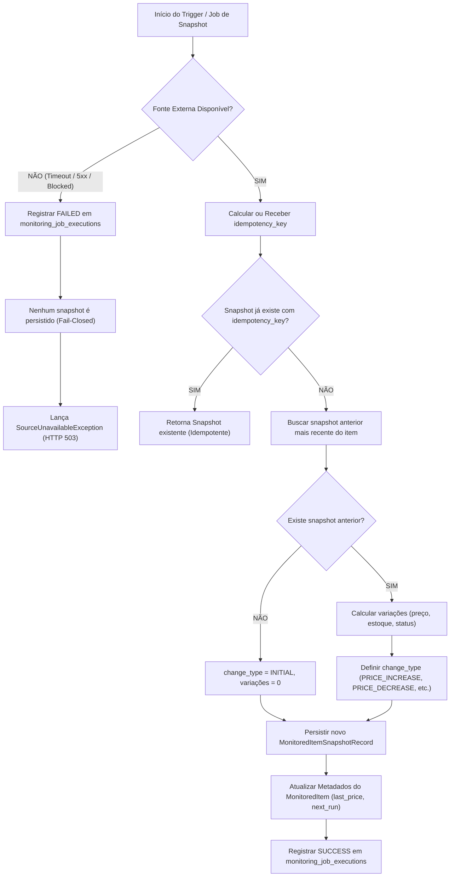

# Especificação Técnica — P013-BE: Snapshots Idempotentes, Detecção de Alterações e Resiliência de Coleta

**Status:** IN_PROGRESS  
**Prompt de Origem:** P013-BE  
**Data:** 18/11/2026  
**Responsável:** Antigravity Agent  
**Contexto:** P012-FE aprovado (Interface de Grupos, Monitoramento de Produtos e Timeline).

---

## 1. Visão Geral e Objetivos do Módulo

O objetivo do prompt **P013-BE** é enriquecer o subsistema de **Snapshots Históricos de Monitoramento** com:
1. **Idempotência Estrita na Ingestão:** Prevenção determinística de duplicatas mediante chave de idempotência (`idempotency_key`), impedindo que execuções duplicadas de coletores, retentativas de rede ou chamadas concorrentes gerem linhas duplicadas para o mesmo evento de observação.
2. **Proveniência, Validade e Timestamps Precisos:** Cada snapshot passa a conter explicitamente `source_url`, `source_type` (`OFFICIAL_API`, `PUBLIC_ENDPOINT`, `LICENSED_CATALOG`), `collected_at` (timestamp UTC do processamento), `observed_at` (timestamp UTC da observação no marketplace), `valid_until` (prazo de validade do dado antes de expirar) e `collection_status` (`SUCCESS`, `PARTIAL`, `FAILED_SOURCE_UNAVAILABLE`).
3. **Detecção Automática de Alterações (Change Detection):** Comparação em tempo de persistência com o snapshot imediatamente anterior (`previous_snapshot_id`), calculando variação absoluta e percentual de preço (`BigDecimal`), alteração de disponibilidade (`available_quantity`), status e classificação do tipo de mudança (`INITIAL`, `NO_CHANGE`, `PRICE_INCREASE`, `PRICE_DECREASE`, `AVAILABILITY_CHANGE`, `STATUS_CHANGE`).
4. **Resiliência Fail-Closed (Sem Dados Fabricados):** Se a fonte externa estiver indisponível (HTTP 5xx, timeout, CAPTCHA, queda de rede, circuit breaker aberto ou kill switch), o sistema **NÃO cria nenhum registro** na tabela `monitored_item_snapshots`. A falha é registrada exclusivamente em `monitoring_job_executions` com o motivo detalhado e lançada como `SourceUnavailableException`.
5. **Decisão sobre Particionamento e Retenção:** Análise técnica justificando a não adoção de particionamento físico no MVP, mantendo a política de retenção via expurgo programado (`MonitoringRetentionService`).

---

## 2. Requisitos Funcionais e Critérios de Aceite

| ID | Requisito | Critério de Aceite |
| :--- | :--- | :--- |
| **FR-SNAP-01** | Snapshots Idempotentes | Ingestão suporta `idempotency_key` explícita ou calculada deterministicamente via SHA-256 (`tenant_id:item_id:epoch_minute:price:quantity`). Duplicatas são descartadas sem erro, retornando o registro já existente. |
| **FR-SNAP-02** | Metadados de Origem e Validade | Registro obrigatório de `source_type`, `source_url`, `collected_at`, `observed_at`, `valid_until` e `collection_status`. |
| **FR-SNAP-03** | Detecção de Alterações | Comparação com o snapshot imediatamente anterior do item. Cálculo preciso de `price_change_amount` e `price_change_percent` (com 4 casas decimais e arredondamento `HALF_UP`), `has_availability_change`, `has_attribute_change` e classificação `change_type`. |
| **FR-SNAP-04** | Fail-Closed quando Fonte Indisponível | Em caso de indisponibilidade da fonte, nenhum snapshot é inserido no banco (`monitored_item_snapshots` permanece inalterado). A falha é auditada em `monitoring_job_executions` e lançada `SourceUnavailableException`. |
| **FR-SNAP-05** | Integridade do Histórico Coletado | O histórico demonstra estritamente dados reais coletados. Nenhuma interpolação, inferência ou dado sintético é injetado. |
| **FR-SNAP-06** | Governança de Retenção & Particionamento | Aplicação da política de retenção por tenant/grupo (`retention_days`). Particionamento de tabela descartado para o volume do MVP (< 1M linhas) por complexidade de RLS e FKs. |

---

## 3. Decisão de Arquitetura: Particionamento vs. Retenção

### 3.1 Avaliação de Volume para o MVP
- **Cenário do MVP:** 1.000 itens monitorados coletando a cada 60 minutos geram ~24.000 snapshots/dia (~720.000/mês).
- **Sobrecarga do Particionamento Declarativo no PostgreSQL 17:**
  - Particionamento por `RANGE (observed_at)` impede foreign keys diretas a partir de tabelas filhas sem que a chave de particionamento faça parte da PK.
  - Adiciona sobrecarga nas políticas de Row-Level Security (RLS) que necessitam de índices globais e verificação em cada partição.
- **Decisão:** O particionamento é tecnicamente injustificado no estágio atual. Adota-se indexação composta otimizada `(tenant_id, item_id, observed_at DESC)` combinada com a rotina de retenção programada (`MonitoringRetentionService`) que expurga dados anteriores ao limiar configurado (`retention_days`).
- **Gatilho Futuro para Particionamento:** Volume superior a 10.000.000 de linhas ou degradação de tempo de consulta histórica > 100ms.

---

## 4. Evolução do Modelo de Dados (Flyway Migration V11)

### 4.1 Campos Adicionais em `monitored_item_snapshots`
- `idempotency_key VARCHAR(64)`: Hash SHA-256 único por tenant.
- `source_url TEXT`: URL ou URI da fonte autorizada.
- `source_type VARCHAR(50) NOT NULL DEFAULT 'OFFICIAL_API'`: Tipo da fonte licenciada/pública autorizada.
- `valid_until TIMESTAMP WITH TIME ZONE`: Validade do dado antes de requerer nova coleta.
- `collection_status VARCHAR(50) NOT NULL DEFAULT 'SUCCESS'`: Status da coleta (`SUCCESS`, `PARTIAL`, `FAILED_SOURCE_UNAVAILABLE`).
- `previous_snapshot_id UUID REFERENCES monitored_item_snapshots(id) ON DELETE SET NULL`: Vínculo ao snapshot anterior.
- `has_price_change BOOLEAN NOT NULL DEFAULT FALSE`: Indicador booleano de mudança de preço.
- `price_change_amount NUMERIC(15, 4) NOT NULL DEFAULT 0.0000`: Variação nominal em moeda.
- `price_change_percent NUMERIC(8, 4) NOT NULL DEFAULT 0.0000`: Variação percentual (`(atual - anterior) / anterior * 100`).
- `has_availability_change BOOLEAN NOT NULL DEFAULT FALSE`: Indicador de mudança em estoque/quantidade.
- `has_attribute_change BOOLEAN NOT NULL DEFAULT FALSE`: Indicador de mudança em status ou atributos.
- `change_type VARCHAR(50) NOT NULL DEFAULT 'INITIAL'`: Classificação da mudança (`INITIAL`, `NO_CHANGE`, `PRICE_INCREASE`, `PRICE_DECREASE`, `AVAILABILITY_CHANGE`, `STATUS_CHANGE`).

### 4.2 Constraints e Índices
- `CONSTRAINT uq_snapshots_tenant_idempotency UNIQUE (tenant_id, idempotency_key)`: Garante idempotência física no banco.
- `CREATE INDEX idx_snapshots_tenant_item_idempotency ON monitored_item_snapshots (tenant_id, item_id, idempotency_key)`: Otimização de lookups.

---

## 5. Algoritmo de Change Detection e Idempotência

---

## 6. Estratégia de Testes

1. **Testes Unitários (`MonitoredItemSnapshotServiceTest`):**
   - Evitar duplicatas quando `idempotencyKey` idêntico for submetido (retornando registro existente).
   - Calcular corretamente variações de preço (`PRICE_INCREASE`, `PRICE_DECREASE`, `NO_CHANGE`) com precisão monetária `BigDecimal`.
   - Calcular corretamente variações de estoque e status (`AVAILABILITY_CHANGE`, `STATUS_CHANGE`).
   - Abortar e lançar `SourceUnavailableException` quando a fonte estiver indisponível, garantindo zero gravações na tabela de snapshots.
   - Manter regra de histórico não retroativo.
2. **Testes de Integração (`ProductMonitoringControllerTest`):**
   - Testar endpoint de trigger com suporte a `idempotencyKey` e falha de fonte externa retornando HTTP 503.
   - Testar endpoints de listagem de snapshots trazendo novos campos de variação e proveniência.
3. **Testes de Integração com Banco Real (`PostgresProductMonitoringRlsIntegrationTest`):**
   - Validação da constraint de unicidade de idempotência no PostgreSQL 17.
   - Validação do isolamento RLS multi-tenant com os novos campos.
