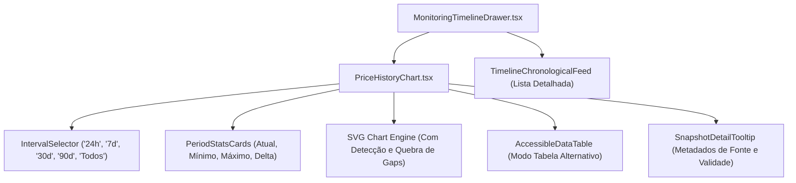

# Especificação Técnica — P013-FE: Gráfico Histórico de Preços, Tooltips de Fonte e Detecção de Lacunas

**Status:** IN_PROGRESS  
**Prompt de Origem:** P013-FE  
**Data:** 19/11/2026  
**Responsável:** Antigravity Agent  
**Contexto:** P013-BE aprovado (Snapshots Idempotentes, Detecção de Alterações e Resiliência de Coleta).

---

## 1. Visão Geral e Objetivos do Módulo

O objetivo do prompt **P013-FE** é implementar uma interface rica, acessível e responsiva para **visualização de histórico de preços de anúncios monitorados**, destacando:
1. **Gráfico Histórico Interativo com Intervalos Selecionáveis:** Suporte a filtros de período (`24h`, `7d`, `30d`, `90d`, `Todos`) com cálculo dinâmico de KPIs (menor preço, maior preço, preço atual e variação percentual do período).
2. **Tooltips Detalhados de Fonte e Auditoria:** Cada ponto de observação exibe preço, moeda, data/hora de observação (`observed_at`), data/hora de coleta (`collected_at`), validade (`valid_until`), proveniência (`source_type`, `source_url`), status de coleta (`collection_status`), estoque disponível (`available_quantity`), status do anúncio e variação contra a observação anterior ($\Delta R\$$ e $\Delta\%$).
3. **Detecção e Sinalização Visual de Lacunas de Coleta (Anti-Alucinação Estrita):**
   - **Regra Inviolável:** *"Não interpolar visualmente dados ausentes como observações reais."*
   - Quando o intervalo entre duas observações consecutivas exceder o limiar de tolerância ($> 2 \times$ `minIntervalMinutes`), o gráfico **NÃO** traça uma linha sólida contínua fingindo estabilidade de preço.
   - Em vez disso, a curva é seccionada em segmentos independentes, com a área da lacuna destacada visualmente (faixa hachurada/translúcida com aviso) e identificador de tempo sem observações.
4. **Acessibilidade Completa (WCAG 2.2 AA):**
   - Papéis semânticos (`role="region"`, `role="img"`, `aria-label` com resumo descritivo do histórico).
   - Navegação completa por teclado (Tab, setas para navegar entre pontos de dados).
   - Alternância para modo **"Visão em Tabela de Observações"**, permitindo a leitores de tela e usuários de acessibilidade navegar em dados tabulares puros com linhas específicas para lacunas (`role="alert"`).
5. **Responsividade Mobile:**
   - SVG responsivo (`viewBox` adaptativo) com controle de toque (tap para inspecionar e fixar o tooltip, toque fora para dispensar).
   - Alvos de toque $\ge 44\text{px}$ em todos os controles interativos.

---

## 2. Requisitos Funcionais e Critérios de Aceite

| ID | Requisito | Critério de Aceite |
| :--- | :--- | :--- |
| **FR-P13-FE-01** | Gráfico Histórico | Exibir curva cronológica de preços reais com escalas dinâmicas de preço e tempo. |
| **FR-P13-FE-02** | Filtros de Período | Intervalos selecionáveis (`24h`, `7d`, `30d`, `90d`, `Todos`) filtrando estritamente os pontos no range solicitado. |
| **FR-P13-FE-03** | Tooltip de Fonte | Hover/focus/tap exibe `observed_at`, `collected_at`, `valid_until`, `source_type`, `source_url`, `price`, `available_quantity`, `change_type` e $\Delta$. |
| **FR-P13-FE-04** | Detecção de Lacunas | Gaps $> 2 \times$ `minIntervalMinutes` geram quebra visual da linha contínua, faixa de aviso e marcador explicativo de ausência de dados. |
| **FR-P13-FE-05** | Modo Tabela Acessível | Alternância direta entre gráfico SVG e tabela HTML semântica com leitor de tela e navegação por teclado. |
| **FR-P13-FE-06** | Mobile Funcional | Touch targets $\ge 44\text{px}$, visualização fluida em larguras $\ge 320\text{px}$, sem overflow horizontal quebrado. |

---

## 3. Arquitetura de Componentes

---

## 4. Estratégia de Testes

1. **Testes de Renderização e Filtros de Período (`PriceHistoryChart.test.tsx`):**
   - Renderiza corretamente pontos de observação e calcula menor/maior preço.
   - Alterna entre períodos `24h`, `7d`, `30d`, `90d`, `Todos` filtrando adequadamente os pontos.
   - Estado vazio quando não há snapshots coletados.
2. **Testes Anti-Alucinação (Lacunas de Coleta):**
   - Verifica que lacunas $> 2 \times$ `minIntervalMinutes` seccionam os caminhos SVG (não desenha linha sólida contínua única).
   - Renderiza marcadores e faixas de lacuna de coleta com aviso explícito de que valores intermediários não são inventados.
3. **Testes de Tooltip e Proveniência:**
   - Ao focar/clicar num ponto, exibe tooltip com `source_type`, link oficial `source_url`, validade `valid_until` e delta.
4. **Testes de Acessibilidade (WCAG 2.2 AA):**
   - Alternância para `Visão em Tabela` renderiza tabela semântica `<table>` com cabeçalhos acessíveis.
   - Navegação por teclado nos pontos com `tabIndex={0}`.
5. **Testes de Responsividade Mobile:**
   - Touch targets $\ge 44\text{px}$ em botões de intervalo e alternância.
