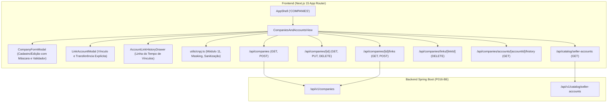

# Especificação Técnica: P016-FE - Cadastro de Empresa e Vínculo de Contas de Marketplace com Proteção de CNPJ

## 1. Visão Geral do Módulo

O módulo **P016-FE** implementa a interface de usuário para gerenciamento de Empresas (Pessoas Jurídicas / Unidades de Negócio) e o vínculo explícito com Contas de Marketplace conectadas (Mercado Livre, Shopee, etc.) no contexto multi-tenant da plataforma Seller Intelligence.

Esta entrega consolida:
1. **Validação e Máscara Sintática de CNPJ em Tempo Real:** Formatação dinâmica `00.000.000/0000-00` e validação imediata pelo algoritmo módulo 11, prevenindo erros de digitação e dígitos repetidos antes da submissão.
2. **Proteção de Privacidade & Anti-Exposição de CNPJ:** Não expor CNPJ completo em logs de depuração/telemetria nem em listagens públicas/gerais sem necessidade. Na listagem, o CNPJ é ofuscado (`12.***.***/0001-34`) com controle acessível para revelar/ocultar sob demanda.
3. **Vínculo Explícito e Prevenção de Ambiguidade:** Seleção inequívoca da conta de marketplace e da empresa receptora. Caso a conta já pertença a outra empresa, o sistema detecta o conflito e exige confirmação formal de transferência (`replaceActiveLink: true`), encerrando o vínculo anterior e mantendo o histórico de vigência.
4. **Aplicação de Permissões por Papel (RBAC):** Usuários com papel de leitura (`VIEWER` / `ANALYST`) visualizam dados cadastrais e vínculos em modo somente leitura, com botões de escrita desabilitados e aviso explicativo. Usuários `ADMIN`, `OWNER` e `OPERATOR` possuem acesso integral.
5. **Responsividade Mobile & Acessibilidade WCAG 2.2 AA:** Interface utilizável em telas móveis a partir de 360px, touch targets $\ge 44\text{px}$, navegação por teclado e semântica de formulários acessível.

---

## 2. Arquitetura de Componentes e Rotas BFF

---

## 3. Cenários de Aceite (Gherkin)

### Cenário 1: Cadastro de empresa com CNPJ mascarado e validação sintática em tempo real
- **Dado** que um usuário administrador acessa o módulo "Empresas & CNPJs"
- **Quando** ele clica no botão "Nova Empresa" e digita `33000167000101`
- **Então** o campo de CNPJ formata automaticamente para `33.000.167/0001-01`
- **E** exibe indicador visual de CNPJ sintaticamente válido
- **E** ao submeter Razão Social "Petrópolis Distribuidora LTDA"
- **Então** a empresa é criada com sucesso e adicionada à listagem.

### Cenário 2: Rejeição no frontend de CNPJ inválido com feedback de acessibilidade
- **Dado** que o usuário tenta cadastrar uma empresa com CNPJ com dígitos repetidos `11.111.111/1111-11` ou checksum incorreto
- **Quando** o campo perde o foco ou o formulário é submetido
- **Então** o botão de submissão permanece bloqueado
- **E** uma mensagem com `role="alert"` informa "CNPJ sintaticamente inválido (verifique os dígitos verificadores)"
- **E** nenhuma requisição desnecessária é enviada ao backend.

### Cenário 3: Exibição segura e mascarada de CNPJ na listagem geral
- **Dado** que a listagem de empresas exibe empresas cadastradas
- **Então** os CNPJs são exibidos por padrão de forma ofuscada (ex: `33.***.***/0001-01`)
- **E** cada linha possui um botão acessível "Mostrar/Ocultar CNPJ" (`aria-label="Revelar CNPJ da empresa X"`)
- **E** em nenhum momento o CNPJ completo é emitido em logs do console ou telemetria não sanitizados.

### Cenário 4: Vínculo explícito de conta de marketplace a uma empresa
- **Dado** que existem empresas cadastradas e contas de marketplace conectadas (ex: Loja Matriz Mercado Livre)
- **Quando** o usuário abre o modal de vincular conta, seleciona a conta e a empresa de destino
- **E** a conta ainda não possui vínculo ativo com nenhuma empresa
- **Então** o botão "Confirmar Vínculo" envia a requisição com `replaceActiveLink: false`
- **E** a conta passa a constar na lista de contas ativas vinculadas daquela empresa.

### Cenário 5: Detecção e confirmação explícita de transferência de conta já vinculada
- **Dado** que a conta "Loja Matriz Mercado Livre" já está vinculada ativamente à Empresa "Alpha"
- **Quando** o usuário seleciona essa mesma conta para vincular à Empresa "Beta"
- **Então** a interface exibe um aviso ostensivo em destaque:
  *"Esta conta já está vinculada à empresa Alpha. Ao vincular à empresa Beta, o vínculo anterior será encerrado e o histórico de vigência preservado."*
- **E** o botão de confirmação exige o aceite da caixa de seleção "Confirmo a transferência desta conta para a nova empresa"
- **E** a submissão envia `replaceActiveLink: true`, registrando a nova versão (v2) sem ambiguidade.

### Cenário 6: Permissões aplicadas por papel (RBAC)
- **Dado** que um usuário autenticado possui o papel `VIEWER` no tenant
- **Quando** ele navega para a tela de Empresas & CNPJs
- **Então** os botões "Nova Empresa", "Editar", "Desativar", "Vincular Conta" e "Desvincular" são desabilitados com indicação visual acessível (`aria-disabled="true"`)
- **E** um banner informativo esclarece que o usuário está em modo somente leitura.

### Cenário 7: Consulta da linha do tempo / histórico de vínculos da conta
- **Dado** uma conta de marketplace que passou por migrações ou desvinculações
- **Quando** o usuário clica em "Ver Histórico de Vínculos"
- **Então** uma gaveta acessível abre com a linha do tempo cronológica
- **E** exibe cada período de vigência (Início, Fim), empresa associada, número da versão e usuário responsável.

### Cenário 8: Responsividade mobile e acessibilidade por teclado
- **Dado** um dispositivo com viewport de 360px de largura
- **Quando** a visualização de empresas e vínculos é carregada
- **Então** os elementos se adaptam em layout vertical sem overflow horizontal descontrolado
- **E** todos os botões e áreas interativas mantêm altura mínima $\ge 44\text{px}$
- **E** todos os modais e gavetas fecham com a tecla `Escape`.
